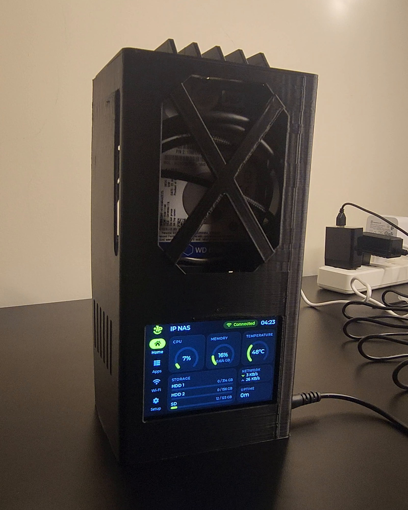
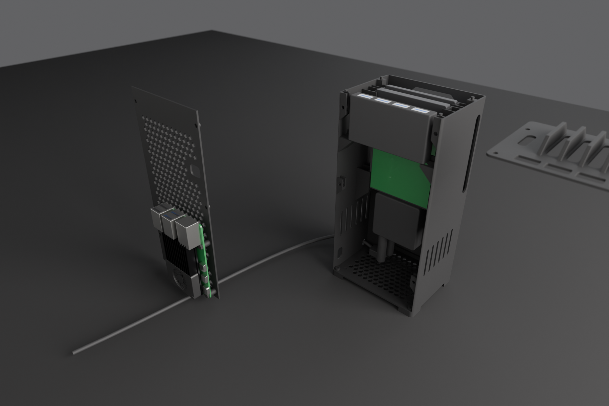
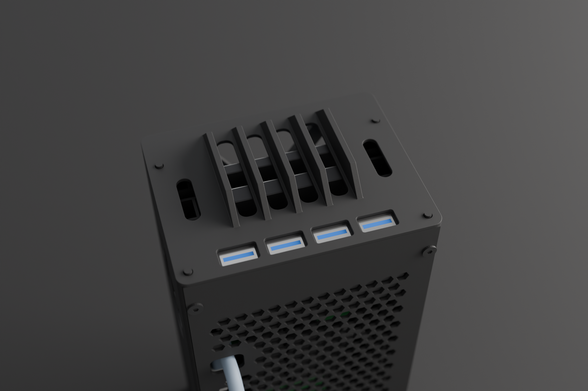

# IP NAS

This is my home NAS, built on a Raspberry Pi 5: two old laptop hard drives, CasaOS with Docker apps, my own AI
assistant (Nur) that you can chat with or call, a 3D-printed case and a 3.5" touch screen running my own firmware.
Everything from the video is in this repo: the parts, the 3D models and measurements, and all the software.



## Parts

Prices are approximate, in USD, from October 2026. Raspberry Pi raised its prices several times in 2026 because of the
memory shortage, so check before you buy. The Amazon and AliExpress links are searches, and sellers change.

| Part | Qty | Price (USD) | Where to buy | Notes |
|---|---|---|---|---|
| Raspberry Pi 5, 4 GB | 1 | 110 | [raspberrypi.com](https://www.raspberrypi.com/products/raspberry-pi-5/) | official resellers per country; the 8 GB board fits the case too |
| Raspberry Pi Active Cooler | 1 | 5 | [raspberrypi.com](https://www.raspberrypi.com/products/active-cooler/) | the Pi 5 throttles without it |
| Raspberry Pi 27W USB-C Power Supply | 1 | 12 | [raspberrypi.com](https://www.raspberrypi.com/products/27w-power-supply/) | 5.1 V, 5 A; with a weaker supply the Pi gives its USB ports 0.6 A instead of 1.6 A |
| microSD card, 64 GB or more | 1 | ~10 | [Amazon](https://www.amazon.com/s?k=microSD+64GB+A1) | A1 or A2; mine is 128 GB |
| USB microSD card reader | 1 | ~2 | [AliExpress](https://www.aliexpress.com/w/wholesale-micro-SD-card-reader-USB.html) | to flash the card on the PC |
| Micro-HDMI to HDMI cable | 1 | ~3 | [AliExpress](https://www.aliexpress.com/w/wholesale-micro-HDMI-to-HDMI-cable.html) | first boot only, with any HDMI screen |
| USB keyboard | 1 | ~8 | [Amazon](https://www.amazon.com/s?k=USB+keyboard) | first boot only |
| 2.5" SATA hard drive or SSD | 2 | | | I used two old ones: WD Blue WD3200LPVX 320 GB (7 mm) and WD Scorpio Blue WD1600BEVT 160 GB (9.5 mm) |
| UGREEN 20611 USB 3.0 to SATA cable | 2 | ~18 each | [Amazon](https://www.amazon.com/s?k=UGREEN+20611+USB+3.0+to+SATA) | each box has a 12 V / 2 A adapter, you only use one of them |
| DC splitter, 1 female to 4 male, 5.5 x 2.1 mm | 1 | ~2 | [AliExpress](https://www.aliexpress.com/w/wholesale-DC-splitter-1-female-to-4-male-5.5x2.1.html) | the 12 V adapter plugs into its socket and its plugs go into the UGREEN cables, so one adapter feeds both drives |
| 4-port USB hub | 1 | ~5 | [AliExpress](https://www.aliexpress.com/w/wholesale-4-port-USB-hub.html) | the case is made for a HAING HI-U302 (77 x 41.4 x 12.1 mm, all 4 ports on one long side), so check the size of any other hub |
| Guition JC3248W535 3.5" touch screen (ESP32-S3) | 1 | ~20 | [AliExpress](https://www.aliexpress.com/w/wholesale-JC3248W535.html) | |
| UGREEN angled USB-C to USB-A cable, 1 m | 1 | ~8 | [Amazon](https://www.amazon.com/s?k=UGREEN+right+angle+USB+C+to+USB+A+cable) | screen to Pi; the angled USB-C end goes on the back of the screen |
| M3x10 screw + M3 nut | 4 + 4 | | | back door |
| M3x6 screw + M3 nut | 4 + 4 | | | legs |
| M2.5x12 nylon screw + M2.5 nut | 4 + 4 | | | Pi on the back door |
| Black PLA | about 156 g | | | the 4 printed parts |

## The build, in the order of the video

### 1. Raspberry Pi OS, first boot and SSH

I flash Raspberry Pi OS Lite (64-bit) with [Raspberry Pi Imager](https://www.raspberrypi.com/software/), boot it once
with a monitor and a keyboard, switch the keyboard to US, connect Wi-Fi and turn on SSH. After that everything happens
from the PC. Every step, from flashing to the apps, is in [pi/README.md](pi/README.md).

### 2. CasaOS

One command over SSH installs CasaOS and Docker:

```bash
curl -fsSL https://get.casaos.io | sudo bash
```

Then open `http://raspberrypi.local` in a browser and create your account.

### 3. The drives

Each drive sits on a UGREEN 20611 cable in one of the blue USB 3 ports. One of the 12 V adapters goes into the DC
splitter, and the splitter feeds both cables. Don't skip it: when I ran two drives on the Pi's USB power alone, the
second one froze for 30 s every time they spun up. Measurements, power tests and drive health are in
[docs/HARDWARE.md](docs/HARDWARE.md). Formatting them and mounting them at `/DATA/HDD1` and `/DATA/HDD2` is in
[pi/README.md](pi/README.md#6-the-drives).

### 4. Nur Hub and local AI

Nur Hub is a small service I wrote that runs on the NAS. The Nur app talks to it to show the NAS status, start and stop
Docker apps, search the web, and download and run local AI models. In CasaOS: **+**, **Install a customized app**, the
import button, paste [hub/docker-compose.yml](hub/docker-compose.yml), **Submit**, **Install**. The compose file pulls
the ready Nur Hub image from Docker Hub (arm64 and amd64), so there is nothing to build. More in
[hub/README.md](hub/README.md).

Here it is, ready to paste:

```yaml
# Nur Hub. CasaOS: + next to Apps, Install a customized app, Import, paste this file. Plain Docker: docker compose up -d
# Image: multix00/nur-hub on Docker Hub (linux/amd64 and linux/arm64), built from the Dockerfile in this folder.
name: nur-hub
services:
  nur-hub:
    image: multix00/nur-hub:latest
    container_name: nur-hub
    restart: unless-stopped
    # Nur Hub manages the NAS itself (status, Docker apps, commands, model downloads), so it needs the host's view:
    network_mode: host   # mDNS discovery + reach llama.cpp / Ollama / SearXNG on 127.0.0.1
    pid: host            # nsenter into the host to run docker / vcgencmd / nmcli / smartctl
    privileged: true     # required by nsenter
    environment:
      NUR_HUB_PORT: "8770"
      NUR_HUB_ALLOW_ADMIN: "1"          # "0" = only the read-only command list, even for paired devices
      NUR_HUB_MODELS_DIR: /DATA/AppData/llamacpp/models
      NUR_HUB_OLLAMA_DIR: /DATA/AppData/ollama
      NUR_HUB_LLAMA_URL: http://127.0.0.1:8088
      NUR_HUB_OLLAMA_URL: http://127.0.0.1:11434
      NUR_HUB_SEARX_URL: http://127.0.0.1:8888
    volumes:
      - type: bind
        source: /DATA/AppData/nur-hub
        target: /var/lib/nur-hub       # paired devices (hashed tokens)
      - type: bind
        source: /DATA
        target: /DATA                  # model downloads land in the same paths llama.cpp / Ollama use
x-casaos:
  architectures:
    - amd64
    - arm64
  main: nur-hub
  author: Nur
  category: Utilities
  developer: Nur
  icon: https://raw.githubusercontent.com/MultiX0/ip-nas/main/app/assets/brand/icon_rounded_1024.png
  tagline:
    en_us: Connect the Nur AI app to your NAS
  description:
    en_us: >-
      Nur Hub lets the Nur app (Android, iOS, Windows) find and pair with this NAS, show its status, start and stop
      Docker apps, search the web through your own SearXNG, download local AI models, and chat with llama.cpp or
      Ollama running here. Open the Nur app on the same Wi-Fi and tap your NAS. The first device becomes the owner.
  title:
    en_us: Nur Hub
  port_map: "8770"
  scheme: http
  index: /api/v1/info
  tips:
    before_install:
      en_us: >-
        Nur Hub needs host access (host network, host PID, privileged) because it manages the NAS: it reads system
        status, controls Docker containers and runs system commands. Only paired devices can use it. Set
        NUR_HUB_ALLOW_ADMIN to 0 to allow only the read-only command list.
```

Nur Hub installs llama.cpp or Ollama for you from the app (NAS > Runtimes > Install). You only need one:

| | llama.cpp | Ollama |
|---|---|---|
| Speed on a Pi 5 | fastest | a bit slower |
| Memory | lowest | a bit more |
| Models | GGUF files, downloaded by Nur (NAS > Models > Get models) | its own library (`ollama pull`) |
| Pick it if | you run it on a Pi (my choice) | you switch between many models |

In the video I use llama.cpp with Qwen3.5 2B (Q4_0, a 1.2 GB download that needs about 2.2 GB of RAM).

### 5. The Nur app

Nur is my Flutter app (Android and Windows; iOS is set up but untested) for chatting with local or cloud models and for voice calls with Fish
Audio Drama 3, in Arabic or English. Open it on the same Wi-Fi as the NAS and tap your NAS: the first device becomes
the owner, and later ones need its approval. Build and setup are in [app/README.md](app/README.md), the voice details
and timings in [docs/FISH_AUDIO.md](docs/FISH_AUDIO.md).

### 6. SearXNG, Nextcloud, Jellyfin, Immich and Tailscale

SearXNG is the web search Nur uses. It isn't in the CasaOS store, so it goes in as a custom app
([pi/README.md](pi/README.md#8-searxng)). Nextcloud (files), Jellyfin (movies and shows) and Tailscale (reaching the NAS
from outside without opening ports) come from the app stores CasaOS ships with. Immich (photo backup) goes in as a custom
app, because the store version is old. My compose files for all of them are in [pi/casaos_apps/](pi/casaos_apps/), and
the fixes I needed, like Nextcloud's trusted domains, are in [pi/README.md](pi/README.md#9-nextcloud).

SearXNG, ready to paste into **Install a customized app**:

```yaml
# SearXNG, the web search Nur Hub uses. Web page and JSON API on port 8888.
# CasaOS: + > Install a customized app > import > paste this file > Submit > Install.
# Nur Hub asks for format=json, so /DATA/AppData/searxng/settings.yml needs json in search.formats,
# or every search answers 403. The settings file is in pi/README.md (SearXNG).
name: searxng
services:
  searxng:
    image: searxng/searxng:latest
    container_name: searxng
    restart: unless-stopped
    ports:
      - "8888:8080"
    volumes:
      - /DATA/AppData/searxng:/etc/searxng
x-casaos:
  architectures:
    - amd64
    - arm64
  main: searxng
  category: Utilities
  icon: https://cdn.jsdelivr.net/gh/selfhst/icons/png/searxng.png
  title:
    en_US: SearXNG
  tagline:
    en_US: Private web search for Nur and your browser
  port_map: "8888"
  scheme: http
  index: /
```

After its first start, run this once on the Pi. Nur Hub asks SearXNG for JSON, and the default settings only allow HTML,
so every search from the hub would get `403 Forbidden`:

```bash
sudo tee /DATA/AppData/searxng/settings.yml > /dev/null <<EOF
use_default_settings: true
server:
  secret_key: "$(openssl rand -hex 32)"
  limiter: false
  image_proxy: true
search:
  formats:
    - html
    - json
EOF
sudo docker restart searxng
```

The other apps, ready to paste the same way (click to open):

<details>
<summary>Nextcloud (files)</summary>

Replace every CHANGE_ME with your own passwords before you install it.

```yaml
# Nextcloud as the CasaOS App Store installs it (BigBear's "Nextcloud": Nextcloud 35 with smbclient, PostgreSQL, Redis
# and a cron container), web page on port 7580. What I changed from the store app:
#   - your own passwords instead of casaos/casaos: replace every CHANGE_ME, the two POSTGRES_PASSWORD values must match
#   - the files go to HDD1 (/DATA/HDD1/nextcloud, owner 33:33, see pi/README.md); the rest stays in /DATA/AppData
#   - NEXTCLOUD_TRUSTED_DOMAINS, so the first visit doesn't end in "Access through untrusted domain"
# The name stays big-bear-nextcloud: CasaOS then offers the store's newer images as updates, and an update only swaps
# the images, so these changes stay.
name: big-bear-nextcloud
services:
  nextcloud:
    container_name: nextcloud
    image: bigbeartechworld/big-bear-nextcloud-with-smbclient:35.0.2@sha256:8fe245e137a6ae96a58b9ad4c5f782efa01197c36b892af1a8a9a6a206369475
    restart: unless-stopped
    ports:
      - "7580:80"
    volumes:
      - /DATA/AppData/big-bear-nextcloud/html:/var/www/html
      # long form on purpose: without the drive the folder is missing and the app doesn't start, instead of
      # filling the SD card
      - type: bind
        source: /DATA/HDD1/nextcloud
        target: /var/www/html/data
    environment:
      POSTGRES_HOST: db-nextcloud
      POSTGRES_DB: nextcloud
      POSTGRES_USER: casaos
      POSTGRES_PASSWORD: CHANGE_ME
      REDIS_HOST: redis-nextcloud
      NEXTCLOUD_ADMIN_USER: casaos
      NEXTCLOUD_ADMIN_PASSWORD: CHANGE_ME
      # only read on the first start; put your Pi's IP instead of 192.168.1.50
      NEXTCLOUD_TRUSTED_DOMAINS: raspberrypi.local raspberrypi 192.168.1.50
      TRUSTED_PROXIES: ""
      OVERWRITEPROTOCOL: http
      PHP_MEMORY_LIMIT: 1024M
      PHP_UPLOAD_LIMIT: 1024M
    depends_on:
      db-nextcloud:
        condition: service_healthy
      redis-nextcloud:
        condition: service_healthy
    networks:
      - nextcloud_network

  db-nextcloud:
    container_name: db-nextcloud
    image: postgres:14.2@sha256:2c954f8c5d03da58f8b82645b783b56c1135df17e650b186b296fa1bb71f9cfd
    restart: unless-stopped
    volumes:
      - /DATA/AppData/big-bear-nextcloud/pgdata:/var/lib/postgresql/data
    environment:
      POSTGRES_DB: nextcloud
      POSTGRES_USER: casaos
      POSTGRES_PASSWORD: CHANGE_ME
    healthcheck:
      test: ["CMD-SHELL", "pg_isready -U casaos -d nextcloud"]
      interval: 10s
      timeout: 5s
      retries: 5
    networks:
      - nextcloud_network

  redis-nextcloud:
    container_name: redis-nextcloud
    image: redis:6.2.20@sha256:d06ff6ec778c7f2a5c0dfaf58141d598efaa50a89d0e966faedfdf122cef451b
    user: "1000:1000"
    restart: unless-stopped
    volumes:
      - /DATA/AppData/big-bear-nextcloud/redis:/data
    healthcheck:
      test: ["CMD-SHELL", "redis-cli ping || exit 1"]
      interval: 10s
      timeout: 5s
      retries: 5
    networks:
      - nextcloud_network

  # Nextcloud's background jobs (every 5 minutes), same image and folders as the web container
  cron:
    image: bigbeartechworld/big-bear-nextcloud-with-smbclient:35.0.2@sha256:8fe245e137a6ae96a58b9ad4c5f782efa01197c36b892af1a8a9a6a206369475
    restart: unless-stopped
    entrypoint: /cron.sh
    volumes:
      - /DATA/AppData/big-bear-nextcloud/html:/var/www/html
      - type: bind
        source: /DATA/HDD1/nextcloud
        target: /var/www/html/data
    depends_on:
      db-nextcloud:
        condition: service_healthy
      redis-nextcloud:
        condition: service_healthy
    networks:
      - nextcloud_network

networks:
  nextcloud_network:
    driver: bridge

x-casaos:
  architectures:
    - amd64
    - arm64
  main: nextcloud
  author: BigBearTechWorld
  developer: nextcloud
  category: Media
  icon: https://cdn.jsdelivr.net/gh/selfhst/icons/png/nextcloud.png
  title:
    en_US: Nextcloud
  tagline:
    en_US: The productivity platform that keeps you in control
  port_map: "7580"
  scheme: http
  index: /
```

</details>

<details>
<summary>Jellyfin (movies and shows)</summary>

The library is `/DATA/HDD1/media`.

```yaml
# Jellyfin as the CasaOS App Store installs it (BigBear's "Jellyfin", the linuxserver.io image), web page on port 8096.
# The only change from the store app: the movies and shows folders are on HDD1 (/DATA/HDD1/media, see pi/README.md)
# instead of /DATA/AppData/jellyfin/data on the SD card. In Jellyfin, add them as /data/movies and /data/tvshows.
# The Pi 5 has no hardware video encoder, so there is no /dev/dri here: Jellyfin transcodes on the CPU.
name: big-bear-linuxserver-jellyfin
services:
  app:
    image: linuxserver/jellyfin:12.1ubu2604-ls50@sha256:51252e7a416e703cdc3cd91e8a54673a2430cc80409be8a38abe511411577b95
    restart: unless-stopped
    environment:
      # CasaOS fills these in (1000, 1000 and the Pi's time zone); the values after :- are for plain docker compose
      PUID: ${PUID:-1000}
      PGID: ${PGID:-1000}
      TZ: ${TZ:-Etc/UTC}
      JELLYFIN_PublishedServerUrl: ""
    ports:
      - target: 8096
        published: "8096"
        protocol: tcp
      - target: 8920
        published: "8920"
        protocol: tcp
      # client discovery and DLNA
      - target: 7359
        published: "7359"
        protocol: udp
      - target: 1900
        published: "1900"
        protocol: udp
    volumes:
      - /DATA/AppData/jellyfin/config:/config
      # long form on purpose: without the drive the folders are missing and the app doesn't start
      - type: bind
        source: /DATA/HDD1/media/tvshows
        target: /data/tvshows
      - type: bind
        source: /DATA/HDD1/media/movies
        target: /data/movies

x-casaos:
  architectures:
    - amd64
    - arm64
  main: app
  author: WisdomSky
  developer: LinuxServer.io
  category: Media
  icon: https://cdn.jsdelivr.net/gh/linuxserver/docker-templates@master/linuxserver.io/img/jellyfin-logo.png
  title:
    en_US: Jellyfin
  tagline:
    en_US: Your movies and shows, streamed from the NAS
  port_map: "8096"
  scheme: http
  index: /
```

</details>

<details>
<summary>Immich (photo backup)</summary>

Replace both CHANGE_ME with the same password, letters and digits only.

```yaml
# Immich, photo and video backup from your phone. Web page and the mobile apps on port 2283.
# This is Immich's own docker-compose.yml from release v3.3.5 (with the values of its example.env written in, because
# CasaOS can't read an .env file), the photos on HDD1 (/DATA/HDD1/immich, see pi/README.md) and the database and the
# model cache on the SD card. Replace both CHANGE_ME with the same password, letters and digits only.
# The name is immich-photos, not immich: CasaOS ties an app to the store app with the same name, and the store's
# "immich" is an older Immich (v2.7.2) that it would offer as an update. To update, change the two v3.3.5 tags
# (read Immich's release notes first).
name: immich-photos
services:
  immich-server:
    container_name: immich_server
    image: ghcr.io/immich-app/immich-server:v3.3.5
    volumes:
      # long form on purpose: without the drive the folder is missing and the app doesn't start
      - type: bind
        source: /DATA/HDD1/immich
        target: /data
      - /etc/localtime:/etc/localtime:ro
    environment:
      DB_PASSWORD: CHANGE_ME
      DB_USERNAME: postgres
      DB_DATABASE_NAME: immich
    ports:
      - "2283:2283"
    depends_on:
      - redis
      - database
    restart: unless-stopped
    healthcheck:
      disable: false

  # face recognition and smart search; the hungry one on a 4 GB Pi (pi/README.md, Immich)
  immich-machine-learning:
    container_name: immich_machine_learning
    image: ghcr.io/immich-app/immich-machine-learning:v3.3.5
    volumes:
      - /DATA/AppData/immich/model-cache:/cache
    restart: unless-stopped
    healthcheck:
      disable: false

  redis:
    container_name: immich_redis
    image: docker.io/valkey/valkey:9@sha256:c123e3715db63d06d4ad6964884037aa0d5d4d703939b9929954112889708e1d
    healthcheck:
      test: redis-cli ping | grep -q PONG || exit 1
    restart: unless-stopped

  database:
    container_name: immich_postgres
    image: ghcr.io/immich-app/postgres:14-vectorchord0.4.3-pgvectors0.2.0@sha256:bcf63357191b76a916ae5eb93464d65c07511da41e3bf7a8416db519b40b1c23
    environment:
      POSTGRES_PASSWORD: CHANGE_ME
      POSTGRES_USER: postgres
      POSTGRES_DB: immich
      POSTGRES_INITDB_ARGS: "--data-checksums"
    volumes:
      - /DATA/AppData/immich/pgdata:/var/lib/postgresql/data
    shm_size: 128mb
    restart: unless-stopped
    healthcheck:
      disable: false

x-casaos:
  architectures:
    - amd64
    - arm64
  main: immich-server
  category: Media
  icon: https://cdn.jsdelivr.net/gh/IceWhaleTech/CasaOS-AppStore@main/Apps/Immich/icon.svg
  title:
    en_US: Immich
  tagline:
    en_US: Photo and video backup from your phone
  port_map: "2283"
  scheme: http
  index: /
```

</details>

<details>
<summary>Tailscale (reach the NAS from outside)</summary>

After install, open its page on port 5252 and log in to your Tailscale account.

```yaml
# Tailscale as the CasaOS App Store installs it (the CasaOS "Tailscale", not BigBear's). It runs on the host network,
# so the Pi itself joins your tailnet and every app on it can be reached at the Pi's Tailscale address (100.x.y.z).
# Log in once at http://raspberrypi.local:5252. No ports to open on the router.
name: tailscale
services:
  tailscale:
    image: tailscale/tailscale:v1.98.3
    container_name: tailscale
    network_mode: host
    restart: unless-stopped
    volumes:
      - /DATA/AppData/tailscale:/var/lib/tailscale
      - /dev/net/tun:/dev/net/tun
    environment:
      TS_STATE_DIR: /var/lib/tailscale
    cap_add:
      - NET_ADMIN
      - NET_RAW
    # tailscaled in the background, then Tailscale's own web page on port 5252 (log in, see the address, log out)
    entrypoint: /bin/sh -c "tailscaled --state=/var/lib/tailscale/tailscaled.state & sleep 10; tailscale web --listen 0.0.0.0:5252"

x-casaos:
  architectures:
    - amd64
    - arm64
  main: tailscale
  author: ZimaOS Team
  developer: Tailscale Inc.
  category: Networking
  icon: https://cdn.jsdelivr.net/gh/IceWhaleTech/CasaOS-AppStore@main/Apps/Tailscale/icon.svg
  title:
    en_US: Tailscale
  tagline:
    en_US: Connect your devices and users together in your own secure virtual private network.
  port_map: "5252"
  scheme: http
  index: /
```

</details>

### 7. The case

A short black tower, 100 x 78 mm and 212 mm tall on its 5 mm legs, printed in 4 parts (about 156 g of PLA, no
supports, one plate). The screen sits in the base, the drives stand behind the front window, the Pi is screwed to the back door with
its ports facing up, and the USB hub sits under the finned top with its ports facing up. I measured every part with a
caliper and modelled it in Blender. Print files, drawings, the Blender model and all the checks are in
[case/README.md](case/README.md) and [case/print_package/](case/print_package/).

| | |
|---|---|
|  |  |

### 8. The screen

A Guition JC3248W535 (ESP32-S3, 3.5", 320 x 480, touch) on one USB cable to the Pi. It runs my own firmware (1.1.0):
live stats, starting and stopping Docker apps, and switching the Pi's Wi-Fi with an on-screen keyboard. A small Python
service on the Pi feeds it (Pi agent 1.0.3 here, the video shows 1.0.2). Firmware, protocol and install are in [docs/PANEL.md](docs/PANEL.md) and
[panel/pi_agent/README.md](panel/pi_agent/README.md).

| Home | Apps | Wi-Fi |
|---|---|---|
|  |  |  |

## Folder map

| Folder | What is in it |
|---|---|
| `app/` | the Nur app (Flutter) |
| `hub/` | Nur Hub, the service on the NAS for the app (Python, Docker image) |
| `pi/` | the setup guide, CasaOS app compose files, a snapshot of my Pi's setup |
| `case/` | the case: print package (STL, 3MF, PDFs, renders), Blender scripts, measurements, fit and slicer checks |
| `panel/` | the touch screen: firmware (PlatformIO, LVGL), the Pi agent, PC test tools, screenshots |
| `docs/` | hardware and power tests, the screen, Fish Audio, local model tests, decisions, the build log |
| `brand/` | my IP logo |

More reading: [why I picked these parts and tools](docs/DECISIONS.md) and the [build log](docs/JOURNAL.md).

## License

MIT, see [LICENSE](LICENSE). The IP logo in `brand/` (and its copies in the case and screen files) and the Nur name and
logo are mine and not covered by the license.
