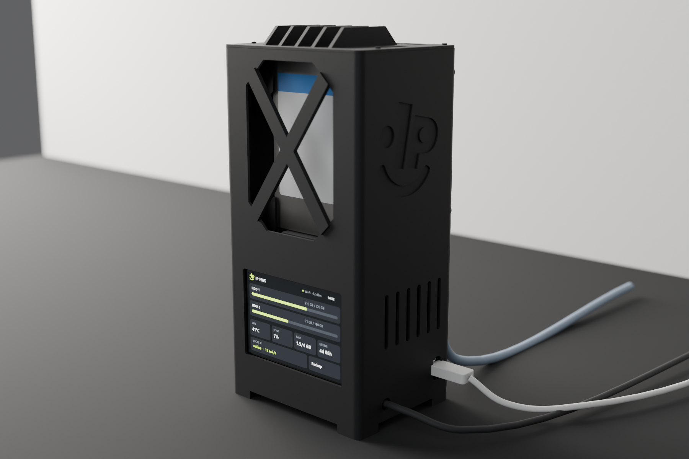

# The case (v6d)

A small black tower for the NAS: 4 printed parts in PLA, one print plate, no supports. I measured every part that goes
inside with a caliper, built the case in Blender with Python scripts, and had it printed at the nearest print shop I
found: I sent them the files in `print_package/` and they printed it.



The screen sits in the base at the front. Behind the X-braced front window the two drives stand on their UGREEN heads,
SATA end down. The Pi 5 is screwed to the back door with its ports facing up, and the USB hub sits under the finned
crown with its 4 ports facing up through it. Outside it is 100 x 78 mm and 206.6 mm tall, 211.6 mm on its legs.

The pictures are Blender renders of the same model the print files come from. The screen in them shows a placeholder
picture; the real screen UI is the panel firmware in `panel/`.

## What gets printed

| Part | File | On the bed | Size (mm) | PLA | Time |
|---|---|---|---|---|---|
| A body | `NAS_v6d_A_body.stl` | upright, open top up | 100 x 79.2 x 197.5 | 110.0 g | 3 h 42 min |
| B back door | `NAS_v6d_B_back_door.stl` | flat, outside face down, standoffs up | 96.5 x 193.4 x 8.4 | 24.4 g | 1 h 32 min |
| C crown | `NAS_v6d_C_crown.stl` | plate down, fins up | 100 x 78 x 11.6 | 18.0 g | 26 min |
| D legs (all 4 in one file) | `NAS_v6d_D_legs_x4.stl` | flat, pins up | 15.6 x 75.6 x 6.3 | 4.0 g | 10 min |
| All 4 on one plate | `NAS_v6d_plate_Bambu_X1C_PLA.3mf` | 256 x 256 bed | | 156.4 g | 5 h 52 min |

The files are in `print_package/01_PRINT_FILES_STL/`. The weights are from PrusaSlicer 2.9.6 (PLA at 1.24 g/cm3);
OrcaSlicer with Bambu PLA Basic says 152.1 g for the whole plate. The times are OrcaSlicer's estimate for a Bambu Lab X1
Carbon (5 h 59 min with the start-up), so a slower printer takes longer.

The body is 197.5 mm tall with its pegs, so the printer needs 200 mm of height. The one-plate layout needs a 200 x 200
bed; on a smaller bed print the back door (193.4 mm long) on its own.

My print shop charges 0.12 JOD per gram of PLA. The whole case is about 160 g, so it cost about 19 JOD
(0.12 x 160 = 19.2).

## Print settings

- PLA, black, 1.75 mm
- 0.4 mm nozzle, 0.20 mm layers (first layer 0.20 too)
- 4 walls: the walls are 1.6 mm, so they print solid
- 5 top and 5 bottom layers
- 15 % gyroid infill
- supports off: every overhang is 45 degrees or a short bridge
- no brim (a 5 mm brim on the body is fine if your bed needs it, it adds 0.5 g)
- part cooling fan at 100 % from layer 3, for the 75.4 mm bridge over the screen window
- elephant foot compensation 0.15 mm, seam aligned at the back
- normal PLA temperatures (the project file uses 220 C)
- scale 100 % and no rotation: the STL files are in mm and already lie the way they print

The 3MF is an OrcaSlicer 2.4.2 project with all 4 parts arranged on one plate, the Bambu Lab X1 Carbon 0.4 nozzle profile,
"0.20mm Standard @BBL X1C" with the settings above and Bambu PLA Basic. It is already sliced and opens in OrcaSlicer
and Bambu Studio. The filament colour in it is the slicer's default orange; print it in black. For any other printer
import the 4 STL files and use the list above.

## Screws and the parts that go inside

Not printed:

- 4 x M3 x 10 screw + 4 x M3 hex nut: back door to body. The nuts drop into slots at the back corners of the body.
- 4 x M3 x 6 screw (low head) + 4 x M3 hex nut: the legs. The screw goes down from inside the case, through the floor,
  into a nut in the leg.
- 4 x M2.5 x 12 nylon screw + 4 x M2.5 nut: the Pi on the door. The screws go in from the outside of the door, the nuts
  sit on the board.

Everything else is held by the shape of the case: the screen slides into a slot, the drives slide between fins, the hub
sits on two ledges, and the crown sits on 4 pegs and holds the hub down.

What goes inside (the full parts list with prices is in the main README):

- Raspberry Pi 5 with the Active Cooler
- two 2.5" drives on UGREEN 20611 USB 3.0 to SATA cables (mine: WD3200LPVX 320 GB, 7 mm, and WD1600BEVT 160 GB, 9.5 mm)
- the UGREEN 12 V adapter and a 4-way DC splitter (5.5 x 2.1), so both drives run from one adapter
- a HAING HI-U302 4-port USB hub. The pocket under the crown is made for it (77 x 41.4 x 12.1, ports on one long
  edge); another hub needs the `HUB_` numbers in `scripts/nas_scene_v6d.py` changed.
- the Guition JC3248W535 3.5" screen with an angled USB-C to USB-A cable
- the official 27 W USB-C supply and an Ethernet cable

## Putting it together

This order works. I also checked it in the model: every part slides in along its path without touching the case.

1. Legs: drop an M3 nut into the hex pocket of a leg, hold the leg under a corner with its pin in the small hole in the
   floor, and screw an M3 x 6 down into the nut from inside. Same for the other 3.
2. Screen: slide it down into the slot behind the front window, glass facing out, until it sits on the ledge. Then plug
   the angled USB-C cable into its back (the plug lies flat on the back near the left edge, seen from the front) and lead
   the cable down past the bottom left corner. The plug does not fit past the drive fins, so plug it in after the screen
   is in.
3. 12 V: the splitter lies on the floor at the front right. Its input lead leaves through the 7 mm hole low in the right
   wall, where the 12 V adapter plugs in. Check that your splitter's lead and plug get through 7 mm; if not, drill the
   hole bigger.
4. Drives: plug each drive into its UGREEN head and a 12 V plug from the splitter into each head. Lower them from the top,
   SATA end down and labels to the front window, until they sit on the shelves: the 7 mm drive in the front lane, the
   9.5 mm drive in the back lane.
5. Drop the 4 M3 nuts into their slots at the back corners.
6. Screw the Pi to the 4 standoffs on the inside of the door with the nylon screws, USB and Ethernet ports at the top.
7. Plug in: the two drive cables into the blue USB 3 ports, the screen cable into a black USB port, the hub cable into
   the other black port (put the hub inside the case, on top of the drives, for now), and the Ethernet cable through the
   hole in the door into the Ethernet port.
8. Slide the door in from the back and screw it to the body with the 4 M3 x 10 screws.
9. Lower the hub onto its two ledges behind the drives, ports up. Its cable goes down through the notch in the left ledge.
10. Press the crown onto the 4 pegs on the top rim.
11. The USB-C power cable goes into the Pi through the window in the right side.

## Measurements

These are the numbers the case is built on. I measured the real parts with a digital caliper and used my numbers, not the
datasheets. All in mm.

| Part | Measured | Datasheet | Used in the model |
|---|---|---|---|
| Raspberry Pi 5 board | 56.00 wide | 85 x 56 x 1.6, holes 58 x 49 apart | datasheet |
| Pi 5 with the Active Cooler, under the board to the top of the fan | 14.2 | 1.6 + 13.7 = 15.3 | 15.3, the safe value |
| Drive 1 WD3200LPVX (320 GB, 7 mm) | 100.0 x 69.50 x 6.4 | 100 x 69.85 x 7.0 | 100 x 69.5, lane 6.8 wide |
| Drive 2 WD1600BEVT (160 GB, 9.5 mm) | 8.9 thick | 9.5 | lane 9.3 wide |
| UGREEN 20611 head alone | 52.3 long x 50.0 x 13.1 | | |
| Drive + head plugged together | 147.8 long, so the head sticks out 47.8 | | 47.8 |
| 12 V plug, metal tip to the end of the rubber | 44.0, about 33.5 of it outside the head | | 33.5 + 10 for the wire bend |
| UGREEN USB-A plug at the Pi, tip to the wire | 39.1 | | 39.1 |
| Screen Guition JC3248W535C_I_Y, front frame | 94.60 x 61.8 | 94.5 x 62.0 | 94.6 x 61.8 |
| Screen thickness, front frame thickness | 12.3, 5.6 | | |
| Raised part on the back of the screen | 82.0 x 57.7, 6.7 high | cut-out 82.9 x 58.4 | 82.0 x 57.7 |
| Angled USB-C plug on the screen's back | sticks out 11.1 (23.4 from the glass) | | 11.1 |
| USB hub HAING HI-U302 | 77.0 x 41.4 x 12.1 | | |
| Hub ports, all on one 77 x 12.1 face | 5.6 from the edge, 4.66 apart, about 12.96 wide | | |
| Hub USB-A plug, hub wire | 39.4, 144 long | | |

The screen's USB-C port is on its back, not on an edge, which is why the screen needs no room at the sides.

The drive lanes are cut for my drives (6.4 and 8.9 thick, lanes 6.8 and 9.3). A drive that is the full 7.0 or 9.5 mm
will not fit, so measure yours first. If they are thicker, change `DRV_T` in `scripts/nas_scene_v6d.py` and export the
files again (see below).

The 12 V plugs decide the height of the base: each drive stands on its head, and the straight 12 V plug sticks out
33.5 mm under the head, so the drives start 93 mm up. I first tried both drives on the Pi's USB power alone: one at a
time they spin up fine, but when both spin up together the second one hangs for 30 s and comes back only after a USB
reset. With the 12 V adapter both woke together 5 times out of 5 with no errors, so the adapter and the room for its
plugs stayed. The power tests are in [docs/HARDWARE.md](../docs/HARDWARE.md).

## Drawings

In `print_package/02_DOCUMENTS/`:

- `NAS_v6d_01_Print_Instructions_A4.pdf`, 7 pages: what to print, the settings, each part on the bed, what to measure
  after printing (the fits that matter, with targets), how it goes together, and the files.
- `NAS_v6d_2D_Blueprints_A3.pdf`, 5 sheets with dimensions in mm, every view at true scale: the assembly, the body, the
  back door, the crown and the legs, and the print plate.

`print_package/03_BLENDER/NAS_v6d_assembly.blend` is the whole model with the textures packed (collections: printed
parts, bought parts, cables, the print copies, studio), and `print_package/04_3D_MODEL/NAS_v6d_assembly.glb` opens in
any glTF viewer. The pictures are in `print_package/05_RENDERS/`.

## Rebuilding the files

Everything is made by the scripts in `scripts/`, so a change is one number and one command. You need Blender 5.2 (I
used 5.2.1) and Python 3 with numpy, matplotlib, reportlab and Pillow (and opencv-python for `logo_trace.py`). The
scripts find their files from their own location, and they read the logo from `brand/` next to `case/`.

From the `case` folder (Git Bash on Windows; on Linux and macOS `blender` is enough):

```bash
B="/c/Program Files/Blender Foundation/Blender 5.2/blender.exe"
"$B" -b -P scripts/nas_scene_v6d.py -- mass       # volume and solid weight of each part
"$B" -b -P scripts/nas_scene_v6d.py -- stl        # the 4 STL files, in print orientation, into out/stl/
"$B" -b -P scripts/nas_scene_v6d.py -- clash      # fit check (see Checks)
"$B" -b -P scripts/nas_scene_v6d.py -- export     # STL, GLB, .blend, the drawing views and dims.json into out/
"$B" -b -P scripts/nas_scene_v6d.py -- hero 128   # one render into render/, 128 samples (default 256)
```

The renders are `hero`, `rear`, `inside`, `exploded`, `top` and `legdetail`. `export` also renders the part pictures
(`pkg_*.png`). The model takes about a minute to build, so every command needs a minute or two before it starts its
real work. The PDFs come from the export:

```bash
cp verification/results/slicer.json out/_build/
mkdir -p out/05_RENDERS && cp render/*.png out/05_RENDERS/   # after rendering hero, exploded and legdetail
python scripts/nas_blueprints_v6d.py out
python scripts/nas_instructions_v6d.py out
```

The slicer numbers in the PDFs come from `slicer.json`; if you change the model, slice it again (see Checks) and update
that file. The 3MF is made with OrcaSlicer: `verification/orca_check.sh --plate`.

Options, as environment variables:

| Variable | What it does |
|---|---|
| `RES` | render size, default `2400x1600` |
| `WIN_E`, `FILL_E` | window and fill light strength, default 60 and 12 |
| `NAS_STL_DIR` | where `stl` writes, default `out/stl` |
| `NAS_PKG` | where `export` writes, default `out` |
| `NAS_OFF` | comma list of feature names (object names in the script, like `xbar` or `hub_lip`) to leave out. I used it with the slicer checks to find which feature caused a warning. |
| `NAS_INSET` | for `clash`: every surface is pulled in by this many mm, so faces that only touch do not count (default 0.15) |

The other scripts:

- `nas_scene.py` is the base the model script runs first: scene, materials, the helpers, the Pi 5 and the UGREEN head.
- `nas_ui_v6.py` draws the placeholder screen picture, `data/ui_dashboard.png`.
- `logo_trace.py` traces `brand/ip_logo.png` into `brand/ip_logo_contours.json`, the outline of the logo debossed 0.8 mm
  into the right side.

## Checks

Before it went to the print shop:

- Fit: the `clash` view tests every printed part against every other part and every bought part (Pi, drives, heads,
  screen, hub, screws and nuts) with all surfaces pulled in by 0.15 mm, then slides the screen, each drive, the hub and
  the Pi door (with the USB and Ethernet plugs in) along the path they go in by. Result: 0 collisions, 5 of 5 paths free
  (`verification/results/assembly_check.txt`).
- Slicers: every part and the full plate sliced with supports off in PrusaSlicer 2.9.6 and in OrcaSlicer 2.4.2 with the
  Bambu Lab X1 Carbon profile. Result: 0 warnings, and OrcaSlicer's `max_cantilever_dist` is 0 (nothing floating). The
  weights and times are in `verification/results/slicer.json`.
- Meshes: `python verification/mesh_check.py` checks the sizes, the volumes and that all 4 STL files are closed, and that
  the 3MF holds the same parts, on the bed. All 4 are closed (the body has 2 zero-area triangles, which slicers drop when
  they load it).

To run the slicer checks yourself (they print the weight, the time and the warnings of each part):

```bash
PRUSA="/c/Program Files/Prusa3D/PrusaSlicer/prusa-slicer-console.exe" verification/prusaslicer_check.sh
ORCA="/path/to/OrcaSlicer/orca-slicer.exe" verification/orca_check.sh
```

Both take the STL folder as an argument (default `print_package/01_PRINT_FILES_STL`, and `out/stl` works too).
`prusaslicer_settings.txt` holds the PrusaSlicer settings. `orca_profiles/` holds the 3 OrcaSlicer profiles as flat
files, which the OrcaSlicer command line needs; `orca_flatten.py` makes them from an OrcaSlicer install.

## Earlier versions

v6d is the seventh try. v4 was a 120 x 92 x 175 box with the Pi lying flat and the drives in a screwed cage, v5 a
one-piece PETG body, and v6 my first tower, which came out too thin and tall. v6b is the short tower with the finned crown
and the front drive window, v6c is v6b rebuilt on my caliper numbers with room for the straight 12 V plugs, and v6d adds
the USB hub under the crown and the 4 legs.

## Files

```
print_package/
  01_PRINT_FILES_STL/   the 4 STL files and the 3MF plate
  02_DOCUMENTS/         print instructions (A4) and drawings (A3)
  03_BLENDER/           the whole model, .blend
  04_3D_MODEL/          the assembly as .glb
  05_RENDERS/           the pictures
scripts/                the Blender and Python scripts that make all of the above
data/ui_dashboard.png   the placeholder screen picture used in the renders
verification/           mesh and slicer checks, slicer settings and profiles, results/
```

`out/` and `render/` are created when you run the scripts.
