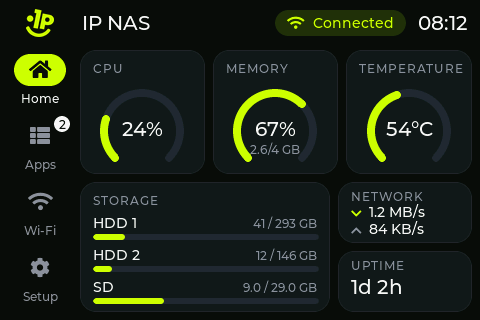
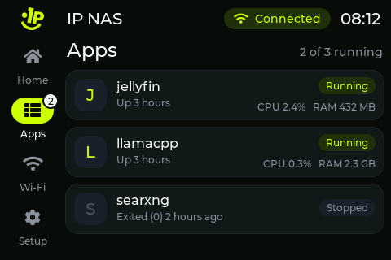
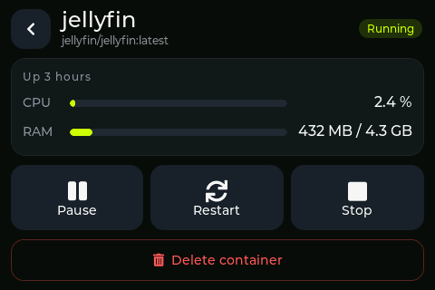
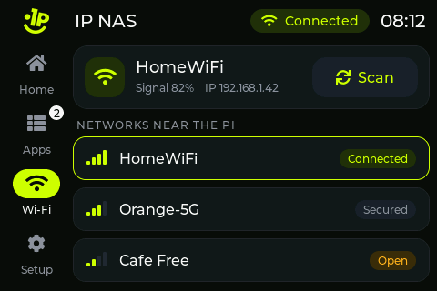
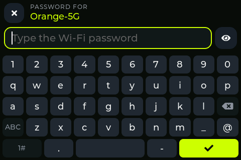
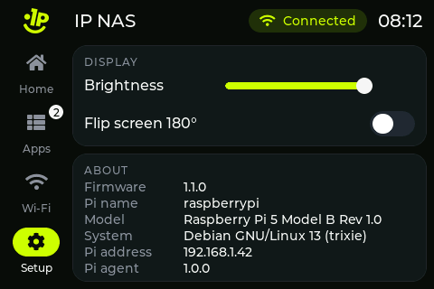

# Touch screen

The screen in the front of the case is a Guition JC3248W535: a 3.5" 320x480 touch screen with an ESP32-S3 on the back.
I wrote my own firmware for it (LVGL, version 1.1.0). It has no Wi-Fi code and stores no passwords: everything comes
over one USB cable from a small Python service on the Pi, `ipnas-panel` (agent 1.0.3), which also runs the commands you
tap.

| Home | Apps | Container |
|---|---|---|
|  |  |  |
| Wi-Fi | Password | Setup |
|  |  |  |

The screenshots come from the real firmware fed with fake data by `panel/tools/panel_test.py`. The Setup one was taken
with an older agent, so it says "Pi agent 1.0.0".

## What it shows

- Home: CPU, memory and temperature gauges, storage, network speed down and up, uptime. The top bar has a Wi-Fi pill
  (connected or not, no network name) and the Pi's clock.
- Storage rows: HDD 1 and HDD 2 are the first two data drives the agent finds, any USB, SATA or NVMe disk that is
  mounted, whatever its name or mount point, in disk order (sda, sdb, ...). SD is the system card. A red "not
  connected" means fewer drives are mounted.
- Apps: the Docker containers (up to 24, running ones first). Tap one for its CPU and RAM and the buttons that make
  sense right now: Start, Stop, Restart, Pause or Resume, and Delete (it asks first; it runs `docker rm -f`, the image
  and the data folders stay).
- Wi-Fi: the network the Pi is on, and the networks near it (it scans when you open the page, at most every 30 s). Tap
  one to switch; the keyboard comes up for the password. If the new network does not come up, the Pi goes back to the
  old one.
- Setup: brightness, flip 180 degrees (both saved on the screen) and the About box: firmware, Pi name, model, system,
  address and agent version.
- "Waiting for the NAS" at power-up and whenever no data has arrived for 6 seconds.

## Parts

- Guition JC3248W535 (mine is the capacitive JC3248W535C_I_Y): ESP32-S3-WROOM-1 N16R8 (16 MB flash, 8 MB PSRAM),
  AXS15231B display driver on QSPI, touch on the same chip over I2C. Price and link in the [README](../README.md).
- A USB-C data cable to the Pi (I use an angled UGREEN USB-C to USB-A). A charge-only cable will not work.
- Measurements are in [HARDWARE.md](HARDWARE.md), the mount in the case in [CASE.md](CASE.md).

Pins, if you want to write your own firmware:

| Function | Pins |
|---|---|
| Display, QSPI | CS 45, SCK 47, D0 21, D1 48, D2 40, D3 39 (no reset pin) |
| Touch, I2C | SDA 4, SCL 8, address 0x3B, 400 kHz |
| Backlight | GPIO 1, PWM (LEDC channel 0, 5 kHz, 8 bit) |
| USB | the ESP32-S3's own USB (USB Serial/JTAG), 115200 |

The panel ignores partial-window writes and has no hardware rotation, so LVGL draws into a full 320x480 framebuffer in
PSRAM that the firmware turns to 480x320 and sends whole.

## Flashing the firmware

### With PlatformIO

Plug the screen into the PC, then:

```bash
cd panel/firmware
pio run -t upload
```

Add `--upload-port COM5` (or `/dev/ttyACM0`) if more than one board is plugged in. The versions are pinned in
`platformio.ini`: espressif32 7.1.3, which brings Arduino core 2.0.17 (the code uses its `ledcSetup` API and does not
build on core 3.x), GFX Library for Arduino 1.6.0, LVGL 8.3.11 and ArduinoJson 7. A build needs about 3 minutes the
first time; it uses 8.6% of the RAM and 11.3% of the app partition.

On Windows, if PlatformIO fails while unpacking the framework (a path that is too long), give it a short folder first:
`set PLATFORMIO_CORE_DIR=C:\pio` in cmd, or `export PLATFORMIO_CORE_DIR=C:/pio` in Git Bash. I build with that.

### With esptool

After a build, `panel/firmware/.pio/build/ipnas_panel/` has `bootloader.bin`, `partitions.bin` and `firmware.bin`, and
`boot_app0.bin` is in the PlatformIO folder under `packages/framework-arduinoespressif32/tools/partitions/`. With those
four files you can flash from any computer that has Python, the Pi included:

```bash
pip install esptool
esptool.py --chip esp32s3 --port COM5 --baud 921600 write_flash -z --flash_mode dio --flash_freq 80m \
  --flash_size 16MB 0x0 bootloader.bin 0x8000 partitions.bin 0xe000 boot_app0.bin 0x10000 firmware.bin
```

esptool 5 calls the program `esptool` and the command `write-flash`. If the screen is plugged into the Pi, stop the
agent first (`sudo systemctl stop ipnas-panel`), because it keeps the port open.

### Download mode

With my firmware on the board, PlatformIO and esptool put it into download mode by themselves: the USB port is the
ESP32-S3's own USB Serial/JTAG, which can reset the chip. A board with other firmware on it may not answer
("No serial data received"). Then:

1. Hold BOOT.
2. Press and release RST.
3. Release BOOT and flash again. The board now shows up as a USB JTAG/serial port (USB ID 303A:1001), maybe on a new
   COM port.

Holding BOOT while you plug in the cable works too. Press RST after flashing if the screen stays dark. When the old
firmware uses the Arduino TinyUSB serial port, opening that port at 1200 baud and closing it also reboots the board
into download mode, no buttons needed.

## Installing the Pi agent

Plug the screen into a USB port of the Pi; it shows "Waiting for the NAS" until the agent runs. Then copy the agent
folder to the Pi and run the installer with bash (not `sh`):

```bash
scp -r panel/pi_agent pi@raspberrypi.local:
ssh pi@raspberrypi.local
cd pi_agent
sudo bash install.sh
```

`install.sh` installs `python3-serial` and `python3-psutil` if they are missing, copies the agent to
`/opt/ipnas-panel/`, installs and enables `/etc/systemd/system/ipnas-panel.service`, restarts it, and prints its
status, the last log lines, the drive rows and the number of containers. Run it again to update. The agent needs
Raspberry Pi OS with NetworkManager (Bookworm or newer) and Docker (CasaOS installs it).

The service runs as root, because it calls `docker` and `nmcli`. It starts at boot after Docker and NetworkManager,
comes back 3 s after any crash with no retry limit, and waits for the screen if it is not plugged in. It finds the
screen by its Espressif USB vendor ID (303A) under `/dev/serial/by-id/` or `/dev/ttyACM*`.

### Checking it

```bash
systemctl status ipnas-panel
journalctl -u ipnas-panel -n 30 --no-pager
journalctl -u ipnas-panel -f
```

The log shows `ipnas-panel agent 1.0.3 waiting for the panel on USB`, then `panel found on /dev/ttyACM0` and
`panel firmware 1.1.0`, and one line per command (`cmd docker stop jellyfin`, `wifi connect MyWiFi`). To see systemd
bring it back, run `sudo systemctl kill ipnas-panel` and check the status again a few seconds later: new PID.

The tests fake psutil, nmcli and docker, so they need neither the screen nor root:
`cd panel/pi_agent && python3 -m unittest -v`.

### Uninstalling

```bash
sudo systemctl disable --now ipnas-panel
sudo rm /etc/systemd/system/ipnas-panel.service
sudo rm -r /opt/ipnas-panel
sudo systemctl daemon-reload
```

## Wi-Fi switching

When you pick a network, the agent remembers the Wi-Fi connection that is up, runs
`nmcli --wait 45 dev wifi connect <name> password <password>` and checks that the Pi is really on the new network. If
not, it deletes the profile that this attempt saved (nmcli keeps it, wrong password and all) and brings the old
connection back with `nmcli con up`. The screen says "If it fails, the Pi goes back to ..." while it waits and then
shows the result, for example "Secrets were required, but not provided. Back on MyWiFi". A typo in the password does
not leave the NAS offline.

One thing nmcli does on its own: if the Pi already knows the network, the password you type replaces the saved one,
even when it is wrong. Type it again correctly if you want the Pi to use that network later.

## USB protocol

One JSON object per line, UTF-8, 115200 baud. `t` is the message type.

From the screen to the Pi:

| Message | Meaning |
|---|---|
| `{"t":"hi","dev":"ipnas-panel","fw":"1.1.0"}` | sent every 2 s; the agent answers each one with `hello` |
| `{"t":"cmd","id":7,"op":"ctr","act":"stop","name":"jellyfin"}` | container action; `act` is `start`, `stop`, `restart`, `pause`, `unpause` or `rm` (`docker rm -f`) |
| `{"t":"cmd","id":8,"op":"wifi_scan"}` | scan for networks; the answer is a `wifi` message |
| `{"t":"cmd","id":9,"op":"wifi_connect","ssid":"MyWiFi","psk":"..."}` | switch networks; `psk` is empty for an open network |

From the Pi to the screen:

| Message | When | Fields |
|---|---|---|
| `hello` | every 10 s and after each `hi` | `host`, `ip`, `model`, `os`, `agent` (version) |
| `stat` | every 1 s | `cpu` %, `ram_u` and `ram_t` bytes, `temp` C (or null), `up` seconds, `disks`, `ssid`, `rssi` (Wi-Fi signal in %, 0 to 100, not dBm), `ip`, `rx` and `tx` bytes per second, `clock` (HH:MM, the Pi's time) |
| `ctrs` | every 3 s, and right after a container command | `list` of `name`, `image`, `state` (Docker's), `status`, `cpu` %, `mu` and `ml` (memory used and limit, bytes); `err` is the Docker error, if any |
| `wifi` | after `wifi_scan` | `list` of `ssid`, `sig` %, `sec` (`open` for no password), `cur` (the Pi is on it); up to 20, current first |
| `res` | after `ctr` and `wifi_connect`, or when a command fails | `id` of the command, `ok`, `msg` (shown on the screen) |

`disks` always has three entries in this order, HDD 1, HDD 2, SD: `{"n":"HDD1","ok":true,"u":41000000000,"t":320000000000}`,
with `ok` false when there is no such drive. The screen keeps up to 24 containers and 20 networks and drops lines
longer than 16 KB, so the agent never sends more. It checks container names against
`[A-Za-z0-9][A-Za-z0-9_.-]{0,127}`, allows only the six actions above and runs the commands one at a time in a worker
thread, so the stats keep coming every second.

Two plain-text debug lines, used by the test tool: `SHOT` makes the screen answer `SHOT 320 480` and then its raw
framebuffer (320x480 RGB565, little endian, portrait); `TAP x y` fakes a touch at x, y (480x320 coordinates) for
120 ms.

## Tools

`panel/tools/panel_test.py` plays the Pi on a PC: it sends sample data, answers commands, taps and saves screenshots.
Plug the screen into the PC (not the Pi) and run, with pyserial installed:

```bash
python panel/tools/panel_test.py COM5 out "shot home" "tap 40 110" "wait 1" "shot apps"
```

Steps are `tap x y`, `wait seconds` and `shot name` (saves `out/name.png`); it expects the screen not flipped.

`panel/tools/logo_to_lvgl.py` turns `brand/ip_logo.png` into `panel/firmware/src/logo.c` (the logo at 28 and 96 px,
RGB565 with alpha). It needs Pillow and runs from the repo root: `python panel/tools/logo_to_lvgl.py`.
